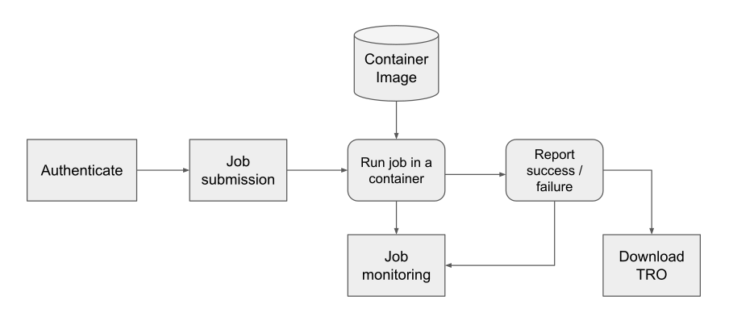
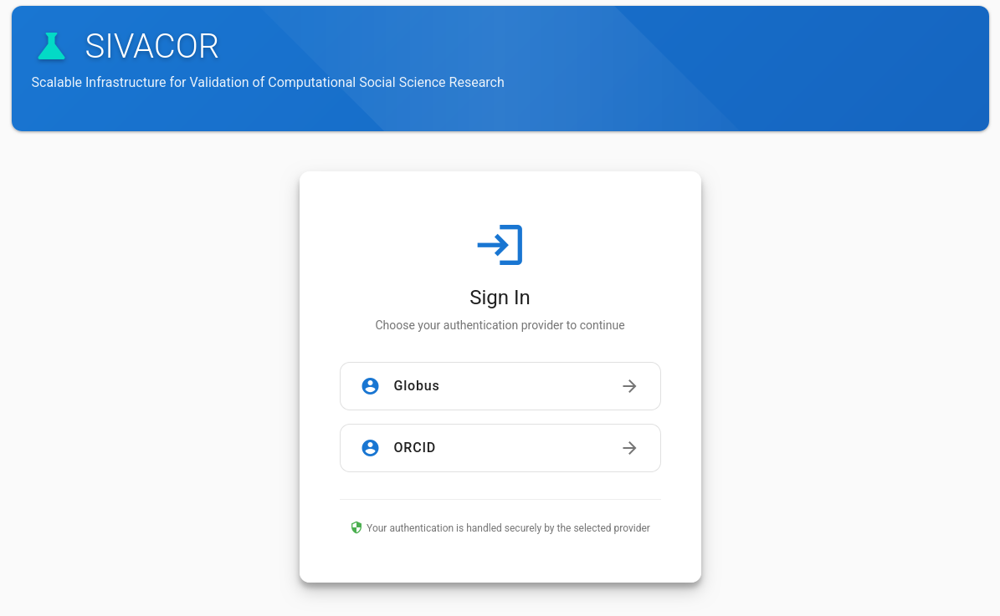
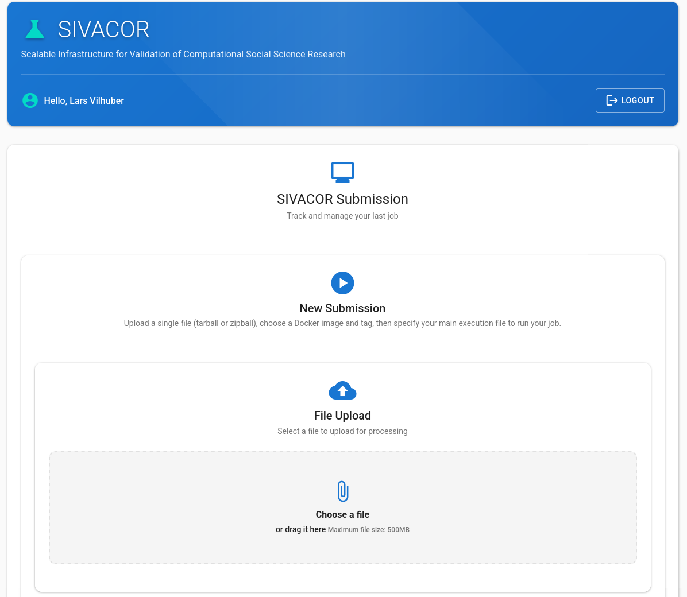
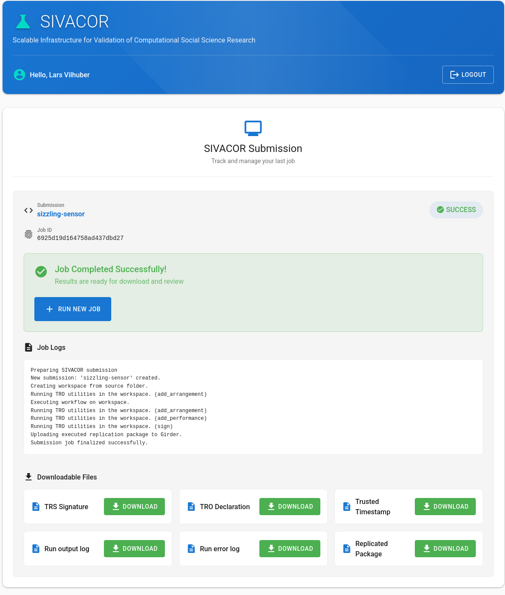

# SIVACOR

## The Reference Implementation

**SIVACOR** is the reference implementation of a TRACE-compliant Trusted Research System (TRS).

## Live {.long-only}

## Upload {.long-only}

## Completed {.long-only}

## How a TRO is made {.long-only}

A simplified walk-through of the [TRACE sample implementation](https://transparency-certified.github.io/trace-specification/docs/sample-implementation/)

## 1. Set up the system {.step-number .center .long-only}

## Set up the system {.long-only}

The organization prepares its **Trusted Research System**:

- Generate a **signing key** (GPG)
- Describe the system's **capabilities** and owner
- Install the TRACE tooling (`tro-utils`)

## 2. Snapshot before {.step-number .center .long-only}

## Snapshot before {.long-only}

Record the **initial state** of the project — code and data exactly as submitted, before anything runs.

## 3. Run the workflow {.step-number .center .long-only}

## Run the workflow {.long-only}

Build and run the **containerized** research code, unattended — push-button.

## 4. Snapshot after {.step-number .center .long-only}

## Snapshot after {.long-only}

Record the **final state**: every file the run produced or changed.

## 5. Add run details {.step-number .center .long-only}

## Add run details {.long-only}

Attach **execution metadata** from the system logs: what ran, on what, with what resources.

## 6. Sign and publish {.step-number .center .long-only}

## Sign and publish {.long-only}

**Sign** the TRO with a trusted timestamp so it cannot be altered, then **publish** it together with the TRS description.

## Who runs SIVACOR?

A SIVACOR instance can be run by a **trusted organization** 

- journal
- university
- research institution hosting other researchers

## What SIVACOR Provides

SIVACOR allows authors to:

1. Demonstrate **push-button reproducibility** in a transparent environment
2. Fix minor bugs **before submission** — without journal resources
3. Receive a **TRACE-compliant TRO** with organizational signature

## What SIVACOR Provides

For journals:

- Packages arrive **already verified**
- TRACE metadata is machine-readable and comparable
- Works for journals **with and without** dedicated data editors

## The Bigger Picture {.long-only}

::: {.fragment}
::: {.highlight-box}
Universities, research data centers, and compute facilities become **producers of credibility** — not just reproducibility services.
:::
:::

## SIVACOR is live.

